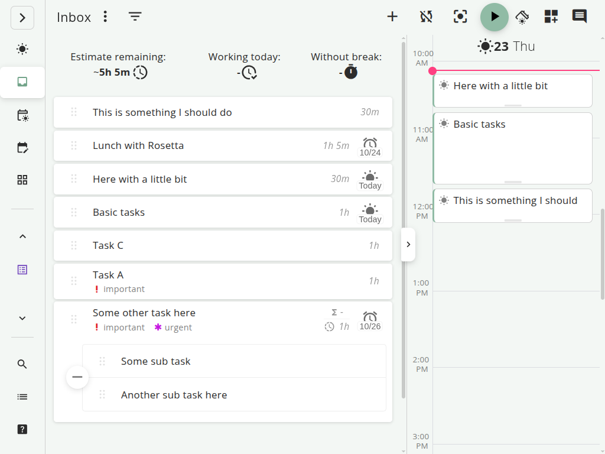
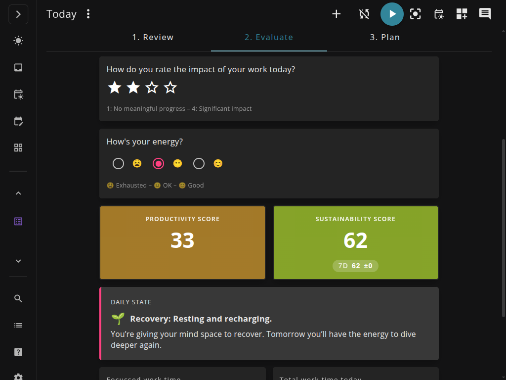
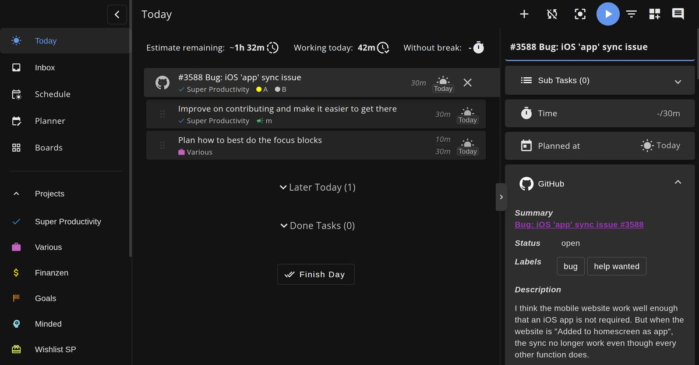

# Super Productivity: Give Every Workday a Clear Finish

Turn a backlog into a day you can actually complete.
Super Productivity combines task planning, focused work, and recorded time so that a task can carry both its next action and the effort already spent on it.

## Decide what deserves today's attention

Start with an outcome that another person could recognize: a reviewed proposal, a corrected defect, or a prepared meeting.
Break a vague assignment into actions that fit between existing commitments.

Projects separate areas of responsibility.
Tags help identify contexts such as review or research without duplicating the same task into several lists.

The super productivity task manager supports compact lists and visual boards.
Use Kanban for movement between stages, or an Eisenhower Matrix when urgency and importance need separate consideration.

Short syntax makes capture faster when the relevant syntax settings are enabled.
Enter these examples individually in the Add Task Bar:

```text
Review invoice layout 25m #review
Draft client questions 40m #writing
Prepare release notes 1h #release
```

The duration sets an estimate; it does not start a timer.
Check the parsed task before moving on, especially when using date expressions or project matching.

The [short-syntax reference](https://github.com/super-productivity/super-productivity/wiki/3.04-Short-Syntax) describes supported forms.
The supplied [ARCHITECTURE-DECISIONS.md](ARCHITECTURE-DECISIONS.md) explains internal distinctions such as a date-only task versus one scheduled for a precise time.

Choose a small set of tasks for today, then compare their estimates with the time left after meetings.
Leave room for interruptions rather than filling every available minute.

[](https://super-productivity-sync.github.io/Super-Productivity/)

## Work from a task, not an anonymous timer

Start tracking from the task you are working on.
When the work changes, switch the active task so the resulting record remains useful.

Use a focus rhythm that fits the activity:

- Pomodoro provides repeated work and break intervals.
- Flowtime supports a rhythm based on the work session.
- Countdown sessions give a piece of work a defined time budget.
- Break reminders make pauses part of the workday.

Stop when the intended outcome is reached, or leave a short note explaining the next action.



For interrupted work, record enough context to resume without reconstructing the whole problem.
A note such as "compare the second export with the approved layout" is more useful than "continue later."

Idle handling depends on the platform.
The browser version needs the companion extension for idle detection, and browser tracking requires the app to remain open.

For super productivity linux contributors, [build-wayland-idle-helper.js](tools/build-wayland-idle-helper.js) builds the native Wayland helper used by the desktop application.
That source tool is distinct from the user's timer controls.

See the [Web App vs Desktop reference](https://github.com/super-productivity/super-productivity/wiki/3.05-Web-App-vs-Desktop) when choosing a client for a particular workflow.

## Let the worklog improve the next estimate

At the end of a work period, compare the plan with the actual record.

| Work item | Estimated | Recorded | Difference | Planning adjustment |
|---|---:|---:|---:|---|
| Review invoice layout | 25 min | 35 min | +10 min | Include browser comparison |
| Draft client questions | 40 min | 30 min | -10 min | Keep the shorter outline |
| Prepare release notes | 60 min | 85 min | +25 min | Separate research from writing |

These numbers illustrate a review method, not an application-generated benchmark.

A useful daily review answers four questions:

1. Which outcomes are complete?
2. Which unfinished tasks still deserve attention?
3. Where did recorded time differ from the estimate?
4. What should be changed in tomorrow's plan?

The super productivity time tracking workflow can feed work summaries and exports.
Before using an export for reporting, check the period, selected projects, and the meaning of each column.

The supplied [super-productivity-overdue.json](tools/test-data/super-productivity-overdue.json) is a test fixture with application-state and export-setting examples.
It is not a template for replacing your working data.

Recurring obligations need an appropriate recurrence rule.
A fixed weekday and an interval after completion represent different commitments.

The [official handbook](https://super-productivity.com/guides/the-super-productivity-handbook/) connects daily planning, focus, and worklog review.
Use a weekly review to remove stale tasks and revise estimates that repeatedly prove unrealistic.

## Keep external issues connected to personal work

Importing an issue preserves a connection to the system where the team coordinates it.
Your personal plan can then include both imported work and tasks that exist only in Super Productivity.

Issue integrations and device synchronization solve different problems.
The first brings work from another service into the app; the second keeps your Super Productivity data available across clients.

Provider capabilities vary.
For example, the GitHub integration imports issues but does not provide GitHub worklog submission or issue status transitions.
Jira supports additional workflow and worklog operations.

Check the [issue-provider comparison](https://github.com/super-productivity/super-productivity/wiki/3.07-Issue-Integration-Comparison) before expecting the same behavior from every connection.
Verify one representative task before relying on an integration for a reporting routine.

Calendar events help explain how much time remains for planned work.
Displaying an event and writing changes back to a calendar are separate capabilities.

## Continue on another device with a deliberate sync choice

Super Productivity Sync is optional; the app can be used with local data.
When you do enable synchronization, configure one provider and confirm that a small change reaches another client.

Nextcloud, WebDAV, Dropbox, and SuperSync offer different hosting and authentication arrangements.
The desktop local-file provider is another option, but it is unavailable in the browser.

SuperSync currently carries a beta designation in the official documentation.
Its end-to-end encryption uses a password you hold; check the current provider guidance before choosing it for your workflow.



For an initial cross-device check:

1. Keep a separate backup of the data you intend to retain.
2. Configure the same provider and account on both clients.
3. Add a clearly identifiable task on the first device.
4. Synchronize and verify it on the second.
5. Edit its note there and confirm the return trip.

Consult the [sync-provider comparison](https://github.com/super-productivity/super-productivity/wiki/3.08-Sync-Integration-Comparison) for supported platforms and encryption behavior.
Synchronization alone does not preserve every earlier version of a task.

The source collection includes several references for investigating device behavior:

- [verify-android-shortcuts.test.js](tools/verify-android-shortcuts.test.js) checks Android launcher shortcut wiring.
- [verify-ios-quick-actions.test.js](tools/verify-ios-quick-actions.test.js) checks corresponding iOS quick-action connections.
- [electron-builder.yaml](electron-builder.yaml) defines desktop packaging details.
- [ngsw-config.json](ngsw-config.json) defines web service-worker asset caching.
- [sync-fuzz-compare.js](tools/sync-fuzz-compare.js) compares synchronization regression signatures across revisions.

Record client versions when investigating a discrepancy.
Different application versions can understand different data formats or expose different settings.

## Separate browser hosting from the sync backend

Serving the web application gives a browser access to its interface.
It does not, by itself, move task storage into a shared database.

With Docker installed, this Docker CLI example serves the published web image on host port 8787:

```bash
docker run -d --name sp-browser -p 8787:80 johannesjo/super-productivity:latest
```

The web client stores its task data in that browser's IndexedDB.
Use the selected sync provider to exchange changes between clients, and keep backups independently.

The [Docker guide](https://github.com/super-productivity/super-productivity/wiki/2.13-Run-with-Docker) distinguishes web hosting, a SuperSync server, and an existing WebDAV service.
For access from other devices, follow its HTTPS and browser-origin requirements.

### Prefill a WebDAV connection

The web container accepts environment variables that prefill WebDAV settings.
This example belongs in an environment file passed to Docker with its `--env-file` option:

```dotenv
WEBDAV_BASE_URL=https://dav.example.org/
WEBDAV_USERNAME=planner
WEBDAV_SYNC_FOLDER_PATH=/super-productivity
SYNC_INTERVAL=5
```

Replace the example server and account with your own values.
The interval is in minutes; these defaults do not supply a password or create a WebDAV account.

The [docker-entrypoint.sh](docker-entrypoint.sh) script translates these variables into client defaults.
The [default.conf.template](nginx/default.conf.template) serves the web app and defines the optional WebDAV proxy route.

### Recognize the supplied test infrastructure

The [docker-compose.supersync.yaml](docker-compose.supersync.yaml) file is an end-to-end test override with test mode enabled.
Use the official server deployment instructions for an actual SuperSync service.

The [wait-for-supersync.sh](scripts/wait-for-supersync.sh) and [wait-for-webdav.sh](scripts/wait-for-webdav.sh) scripts wait for test services.
They are references for the test harness, not general client connection instructions.

For source-level context, [package.json](package.json) lists application scripts and dependencies.
The [angular.json](angular.json) file defines frontend build configurations.

## Adapt the workspace around the work

Themes can make a busy planning screen easier to read.

The supplied [theme-assets.test.js](tools/theme-assets.test.js) checks theme assets, while [check-css-vars.js](tools/check-css-vars.js) detects unresolved CSS custom properties.
The [test-lng-files.js](tools/test-lng-files.js) utility checks localization resources.

Plugins extend the application, but platform requirements differ.
A plugin that requires Node.js execution needs the desktop application.

The [verify-community-plugins.js](tools/verify-community-plugins.js) utility validates entries in the community plugin listing.
Consult plugin documentation for supported versions and permissions before adding an extension.



Assistant access is another optional desktop connection.
Choose the permissions in the application and generate an access key before connecting a client.

The supplied [README.md](tools/mcpb/README.md) explains the Claude Desktop bridge.
Its [manifest.json](tools/mcpb/manifest.json) describes the extension, [index.js](tools/mcpb/server/index.js) relays messages, and [pack.js](tools/mcpb/pack.js) packages the bundle.

For readers exploring super productivity open source, [LICENSE](LICENSE) contains the MIT terms.
The linked files are selected Super Productivity materials; this collection is not a complete buildable application checkout.

## Related Search Terms

Super Productivity Sync, Super Productivity, super productivity task manager, super productivity open source, super productivity time tracking, productivity, task-manager, time-tracking, time-tracker, local-first, privacy, pomodoro, issue-tracker, to-do-list, open-source
